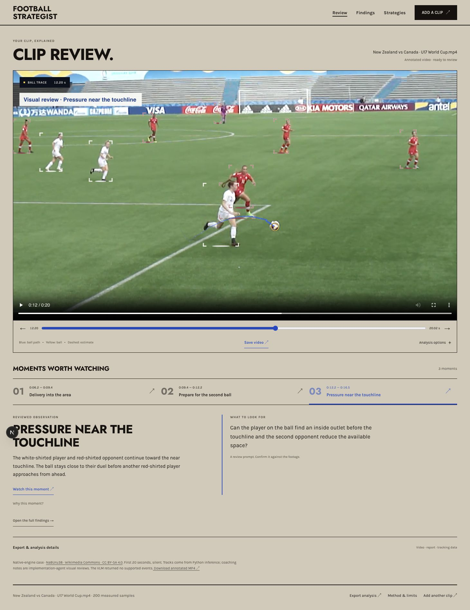

# Football strategist

[](https://github.com/OsamaMoftah/Football-strategist-/actions/workflows/ci.yml)
[](LICENSE)

Review a football clip, follow the ball, and turn measured observations into a focused coaching review. Uploaded clips can run in a browser worker or, in the Docker edition, a queued native Python service. The included case uses a native Python engine with precomputed observations. The app connects video playback, an annotated overlay, timestamped moments, sequence explanations and downloadable evidence.

**[Open the live demo](https://football-strategist.vercel.app/)** · [Architecture](docs/ARCHITECTURE.md) · [Validation](docs/VALIDATION.md) · [Deployment](docs/DEPLOYMENT.md) · [Model and media licenses](THIRD_PARTY_NOTICES.md)



## Try the case

1. Choose **Open annotated demo** to open a licensed 20-second U17 match sequence with genuine, saved model observations immediately.
2. Play or scrub the footage. The cobalt trace, yellow ball marker and magnifier follow the video clock.
3. Choose a timestamp in **Moments worth watching**, then use **Watch this moment** to play from that point. A short observation and coaching question sit below the footage; **Why this moment?** reveals supporting measurements.
4. Open **Analysis options → Run browser pass** to run inference locally, or upload your own MP4/WebM. **Correct ball** supplies an explicitly labeled manual anchor.
5. Use **Save video** for the annotated silent clip, or expand **Export & analysis details** for tracking JSON and written findings. Select a strategy lens to guide the human review.

The included native case is 1280×720 stadium footage, processed at 29.97 ball samples/s and 9.99 player samples/s. Its three coaching notes are implementation-agent visual reviews; the experimental local VLM returned no supported events. It deliberately exposes unresolved-ball gaps rather than hiding them. For your own case, use a 5–15-second uninterrupted wide view with a visible ball and distinct kit colors. The technical limits are 60 seconds and 200 MB; longer clips can take several minutes.

## What is implemented

| Capability | Implementation |
| --- | --- |
| Player candidates | RF-DETR Nano COCO, full-frame plus four overlapping crops, 2 Hz |
| Ball anchors | Separate football-specific RF-DETR Nano, ROI search and extra detector checks when appearance matching fails |
| Ball movement | 12 Hz sampling with labeled detector/manual anchors, local appearance estimates and ≤0.2 s interpolation |
| Continuity | Geometry gates, temporal association, shot-cut resets and split lost-ball segments |
| Sequence cues | Sustained ball proximity, kit-color groups, conservative pressure/control-change prompts, camera-translation-adjusted movement |
| Review | Full-width media-clock overlay, precise scrubber, motion-sample stepping and click-to-play moments |
| Delivery | Annotated silent video, schema-versioned tracking JSON and Markdown findings |
| Privacy | Browser mode stays on-device; native mode uses private, ephemeral server jobs with disclosed retention |

The separate **synthetic pitch sample** demonstrates geometric telemetry with generated coordinates. It is clearly labeled and is never substituted for uploaded-video analysis.

## Native uploads

The Docker edition now includes **Native CPU server** processing for your own clips: 30 seconds / 100 MB / up to 1080p and 60 FPS. Uploads have private job receipts, progress, cancellation and automatic cleanup. The browser verifies each returned result against the uploaded file's SHA-256. Browser processing remains the default; choosing native explicitly uploads the clip to this host. [Usage, API and retention](docs/NATIVE_UPLOADS.md).

## Native-engine case

The new case processed 600 frames in 242.6 seconds on Apple M5 CPU inference. It produced 500 retained ball points before review. A visual review excluded 21 points following a printed football on an advert; the demo retains **479 points across four segments**, including a longest 9.0-second segment. These counts describe continuity, not accuracy. Raw points, exclusions, sampled checks and unsuccessful VLM outputs are included in `public/demo/u17/`.

## Validation boundary

This is a working analyst-assistance portfolio MVP, not a validated automated tactics or officiating system. Ball tracking can drift or fail, team colors can include officials, and proximity does not establish possession. The app withholds cues when evidence is insufficient. Formation recognition, calibrated speed, offside, territory and xT are **not computed from uploaded clips**.

On the older 3.39-second browser case, the saved browser run retained 14 ball detector anchors and 9 appearance estimates, yielding **1.7 seconds of continuous trace across two segments**. Processing took 90.1 seconds on the development machine. Those are single-clip continuity/runtime measurements, not precision, recall or general accuracy. See [the validation report](docs/VALIDATION.md) for protocol, evidence and remaining gates.

## Run locally

Requirements: Node.js 22 or 24 and pnpm 9.15.5. No API keys, paid inference service or GPU required.

```bash
git clone https://github.com/OsamaMoftah/Football-strategist-.git
cd Football-strategist-
corepack enable
pnpm install --frozen-lockfile
pnpm dev
```

Open `http://localhost:3000`. Model files are included with notices and SHA-256 checksums; the build copies ONNX Runtime's WASM assets from the pinned package. The first inference session loads approximately 63 MB of models plus the runtime. Later visits can use browser caching. Network access is needed during build for Next.js font acquisition.

```bash
pnpm verify                         # assets, formatting, types, lint, CV tests, production build
python3.12 -m venv pipeline/.venv
pipeline/.venv/bin/pip install -r pipeline/requirements-offline.txt
PYTHONPATH=. pipeline/.venv/bin/pytest pipeline/tests -q
```

Python includes native CV, annotated MP4 rendering, local VLM proposals, explicit review tooling and an ephemeral upload service in Docker. Vercel uses browser inference. See [native processing instructions](docs/NATIVE_ENGINE.md). Browser inference supports current Chromium desktop browsers best; video recording depends on MediaRecorder support and requires the tab to stay visible. Mobile layout is tested separately from on-device mobile inference.

## Deploy

Vercel: import this repository, use `pnpm build`, and retain the default Next.js settings.

Hugging Face: this repository includes Docker Space metadata and a non-root, port-7860 Dockerfile. See [deployment instructions](docs/DEPLOYMENT.md). Hugging Face publication is not automatic and has not been claimed as live.

## Project layout

```text
src/app/                  Application state, fonts and Werkstatt design system
src/components/           Review, sequence intelligence, findings and strategy views
src/lib/cv/               Worker inference, ball association, appearance, cues and export
src/lib/cv/tests/         Deterministic behavioral tests
public/models/            Licensed ONNX models and provenance
public/demo/              Licensed footage and genuine saved observations
pipeline/                 Native inference, tracking, review, rendering and geometry helpers
docs/                     Architecture, validation and deployment guides
.github/workflows/        Web/Python checks and container smoke test
```

## Commercial use and license

Original application code is [MIT licensed](LICENSE), including commercial reuse with preservation of the notice. **Model weights, runtime files and photographs/footage keep their own licenses**; see [third-party notices](THIRD_PARTY_NOTICES.md). The included Wikimedia video and annotated derivatives are CC BY-SA 4.0. Use footage you have permission to process and distribute.

Commercial deployment still needs representative labeled-footage evaluation, a target-device performance budget and human review appropriate to the intended workflow. See [the operational readiness checklist](docs/VALIDATION.md#before-commercial-operation). No accuracy, officiating, regulatory or commercial-readiness certification is implied.
