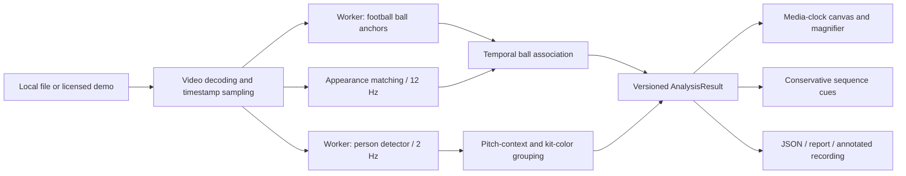

# Architecture

## Native case

`pipeline.analyze_video` decodes every source frame, runs the same ONNX weights through native CPU ONNX Runtime and associates source-coordinate observations. Ball inference uses ROI/global crops at 29.97 Hz; player observations use five crops every third frame. Optical flow/RANSAC estimates camera translation and detects cuts. Hungarian matching associates player candidates; identities are short-term segments.

`pipeline.propose_events` samples timestamped frames for a localhost Ollama instruction model. Raw response, sampling hashes, model digest and prompt remain separate from review records. The selected model returned no supported events on this case. `pipeline.review_analysis` applies explicit, source-hash-bound exclusions and visual-review notes without changing raw inference. `pipeline.render_video` checks the source hash and writes a silent H.264 derivative atomically. See [native CLI instructions](NATIVE_ENGINE.md).

The browser viewer loads the native case's JSON and source MP4. Uploaded clips continue through the browser worker below. The Docker edition also exposes a same-origin native job API with bearer-protected status/results, bounded streamed uploads, one inference subprocess and expiry cleanup; see [native uploads](NATIVE_UPLOADS.md). Vercel does not run that service.

## Data flow

`page.tsx` owns the active source, results, navigation and selected review lenses. `ClipAnalysis` remains mounted during navigation so processing and results survive view changes. Replacing a source aborts the old worker. Cancellation rejects outstanding requests and releases the media element/object URL.

## Measurement versus presentation

`AnalysisResult` has `schemaVersion: 1` and `pipelineVersion: 2` (browser) or `3` (native). Positions are normalized **source-image** coordinates. `frames` preserves sampled raw detector candidates, short-term track IDs, camera observations and appearance attributes. `ballTrack` separately records accepted centers, timestamp, segment, source (`detector`, `appearance`, `manual`), score and camera offset. Scores are not calibrated probabilities of correctness. Segments are not player identities.

Drawing reads `video.currentTime`, scales to the fitted source rectangle, and respects device pixel ratio. A short interpolation is created for rendering only and does not masquerade as another detector measurement. Long gaps and cuts never connect into a trajectory. Annotated export calls the same drawing function as the viewer.

## Ball and sequence logic

- Football detector input: RGB 384×384, `[0,1]`, ImageNet mean/std; classes 0 and 1 are synonymous ball foreground, 2 is background.
- Original COCO model input: RGB `[0,1]` with its published preprocessing; do not apply the football model's normalization to it.
- Full-frame plus crop acquisition gives way to ROI searches near the current ball. Failed appearance matches trigger extra detector checks.
- Geometry, plausible displacement and temporal continuity gate ball associations. Local normalized correlation supplies explicitly labeled short-lived appearance estimates.
- Coarse camera translation and histogram cut detection reduce camera-only cues. Zoom and projective changes are not corrected.
- Pitch-context filtering reduces spectator contamination. Torso-color clustering groups eligible people; officials and occlusions remain failure cases.
- Sustained unambiguous proximity supports a control proxy. Only supported temporal patterns become review cues, with their evidence and verification question. Descriptive ball progression is not labeled a confirmed switch of play.

## Security and privacy

There is no clip upload API, model-service credential or telemetry integration. Inference assets are served by the app. Clips, decoded frames and outputs live in browser memory; downloads are user-triggered. Serving infrastructure still receives normal page/asset requests. Results are not persisted across a full page reload. Limits reject oversized/long clips before inference. Runtime assets and included model/media bytes are checked with SHA-256.

## Extension boundaries

A server inference adapter, calibrated field map, stable player identities, validated team classification and actual tactical recognition would need distinct contracts and labeled evaluations. The Python homography/offside/metrics helpers do not provide these capabilities for uploaded footage. Keep them separate from measured browser outputs.
